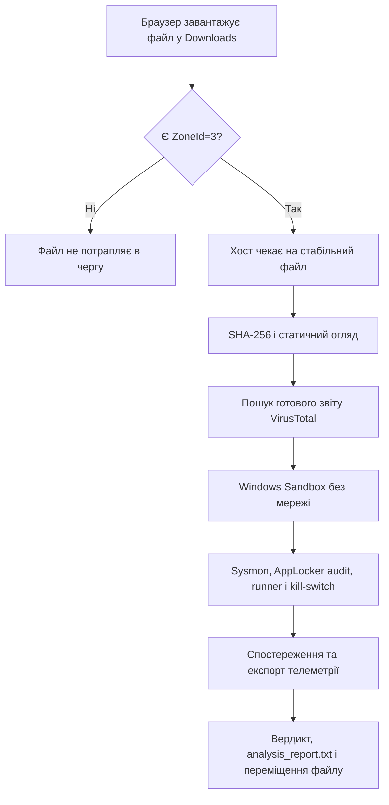

# RBI: ізольований аналіз браузерних завантажень

Демонстраційний прототип EDR-подібного конвеєра для статичного огляду та запуску файлів, завантажених браузером, у Windows Sandbox.

> Цей опис відповідає технічному звіту зі станом на **23.11.2026**. Прототип не є повноцінним EDR і не доводить безпечність файлу. Поточні зміни у скриптах можуть відрізнятися від перевіреного у звіті стану.

## Призначення та межі

RBI демонструє послідовний процес перевірки файлу: черга завантажень, статичні відомості, пошук готового вердикту VirusTotal, виконання у Windows Sandbox, телеметрія Sysmon, кеш вердиктів, реакція kill-switch і звіт.

Конвеєр бере файли лише з `%USERPROFILE%\Downloads`, якщо на файлі є браузерна мітка `Zone.Identifier` із `ZoneId=3`. Файли з інших папок і без цієї мітки не входять у чергу. Одночасно обробляється один файл і запускається один екземпляр Sandbox.

У звіті зі станом на 23.11.2026 надсилання файлів у VirusTotal було вимкнене. У поточній копії `$VirusTotalUploadEnabled = $true`: спочатку шукається звіт за SHA-256, а якщо готового звіту немає, файл може бути надіслано на аналіз. VirusTotal попереджає, що надіслані зразки можуть стати доступними спільноті. Не залишайте у контрольованій папці приватні файли. Для запитів потрібен `VT_API_KEY` у профілі Windows облікового запису, під яким працює підвищений процес. Мережа гостьової системи лишається вимкненою.

## Як проходить аналіз



Статичний огляд PE та ZIP, підписів, імпортів, рядків URL/IP й інших ознак додає інформацію до звіту, але сам по собі не змінює вердикт. У звіті описано 35-секундне спостереження за зразком; це характеристика перевіреного стану на дату звіту.

Гість має доступ до кешу вердиктів лише для читання, а записує кеш хост. Kill-switch у Sandbox читає події створення процесів Sysmon і завершує процес лише тоді, коли SHA-256 є у кеші зі статусом `MALICIOUS`. Невідомі процеси класифікуються та журналюються, але не вбиваються лише через поведінковий сигнал.

## Що означають результати

| Вердикт | Значення у прототипі |
|---|---|
| `VIRUS` | VirusTotal або кеш дає вердикт `MALICIOUS`; цей хеш може бути записаний у кеші та використаний kill-switch. Перевірку на реальному шкідливому зразку у звіті не підтверджено. |
| `NO DETECTION` | Заданий набір перевірок завершився без виявлень і має достатні дані VirusTotal. Це не доказ безпечності. Реальні результати такого типу у звіті відсутні. |
| `SUSPICIOUS` | Є підозріла ознака, яку конвеєр може подати на розгляд. Гостьовий сигнал сам по собі не є доказом шкідливості. |
| `INCONCLUSIVE` | Немає достатніх даних або аналіз не завершився повністю. Файл залишається для ручного розгляду. |

Кеш зберігає `VIRUS → MALICIOUS` і `NO DETECTION → CLEAN`; `MALICIOUS` не понижується до `CLEAN`. Підозрілі та неповні результати не додаються до кешу.

Класифікація системних процесів вимагає більше, ніж назву чи шлях: клас `SIGNED-SYSTEM` потребує валідного підпису Microsoft і точного збігу шляху та SHA-256 з еталоном. Підписаний файл, відсутній в еталоні, позначається для розгляду. Еталон прив'язаний до гостьової збірки Windows.

## Склад проєкту

Основні файли у `sandbox scripts/`:

| Файл | Призначення |
|---|---|
| `start-rbi.ps1` | Хостовий конвеєр: черга, SHA-256, статичний огляд, пошук VirusTotal, Sandbox, вердикт, переміщення і звіт. |
| `Build-RbiPackage.ps1` | Створює пакет розгортання та `manifest.csv` із вказаної вихідної папки й еталона. |
| `sandbox.wsb` | Конфігурація Sandbox і підключення папок; мережа вимкнена. |
| `sandbox-bootstrap.cmd` | Старт у гості: налаштування Week 1, kill-switch, runner та експорт телеметрії. |
| `sandbox-runner.ps1` | Запускає зразок у гості та повідомляє стан спостереження. |
| `edr-week1/guest-edr-week1.ps1` | Встановлення Sysmon і AppLocker у режимі аудиту та експорт журналів. |
| `edr-week1/guest-killswitch.ps1` | Перевірка процесів за кешем і класами довіри; запис heartbeat та журналу. |
| `edr-week1/RbiHashCache.ps1` | Хостовий кеш вердиктів і монтування кешу та еталона лише для читання в гостя. |
| `edr-week1/RbiStaticAnalysis.ps1` | Інформаційний статичний огляд PE, ZIP, підписів та рядків. |
| `edr-week1/EdrWeek1Report.ps1` | Підготовка гостьових скриптів і секції телеметрії у звіті. |
| `edr-week1/sysmonconfig-week1.xml` | Конфігурація Sysmon. |
| `edr-week1/applocker-audit-week1.xml` | AppLocker у режимі аудиту; блокування не вмикається. |
| `edr-week1/Collect-GuestBaseline.ps1` | Ручне створення еталона системних виконуваних файлів при зміні збірки гостя. |
| `Deploy-RbiPackage.ps1` | Перевіряє пакет за маніфестом і розгортає його. |
| `run-sandbox.bat` | Зручний запуск головного скрипта із запитом прав адміністратора. |
| `Compare-RbiCopies.ps1` | Порівняння версій файлів за відомими хешами. |

Звітний пакет розгортання містив 16 файлів і `manifest.csv`; еталон постачається як `baseline.zip` і розпаковується під час розгортання. У поточній папці `sandbox scripts/` є `Build-RbiPackage.ps1`, `baseline.zip` і `manifest.csv`. Збирач бере CSV еталона з `-BaselineCsv` (типово `C:\Quarantine_Zone\Baseline\baseline.csv`) і створює з нього `baseline.zip`.

## Передумови

- Windows 10 або 11 Pro чи Enterprise із підтримкою Windows Sandbox.
- Увімкнена функція **Windows Sandbox** (`Containers-DisposableClientVM`) і перезавантаження після її встановлення.
- PowerShell 5.1 та права адміністратора для розгортання і запуску.
- Щонайменше 10 ГБ вільного місця на диску `C:` для Sandbox і журналів.
- Інтернет на хості під час розгортання, якщо Sysmon ще не встановлений; інтернет потрібен також для запиту VirusTotal за хешем.
- Гостьова Windows має відповідати збірці, для якої створений еталон. У звіті еталон містить 8 714 записів і відповідає Windows 10 Enterprise 24H2, build `26100.9974`.

У кожному новому вікні PowerShell дозвольте запуск скриптів лише для цього процесу:

```powershell
Set-ExecutionPolicy -Scope Process -ExecutionPolicy Bypass -Force
```

Перед демонстрацією перевірте `winver`: у звіті назва VM та визначені скриптом редакція/збірка хоста не збігалися повністю.

## Збирання та розгортання

Звітний процес створює пакет із робочої папки, а потім розгортає його в постійне місце. Приклад зі звіту:

```powershell
# Запустити з папки актуальних вихідних скриптів.
# Build-RbiPackage.ps1 видаляє OutDir, якщо він уже існує, тому створюємо нову унікальну папку.
Set-Location "C:\Users\megaIvan\Desktop\sandbox scripts"
$packageDir = Join-Path $env:TEMP ("RBI-package-" + [guid]::NewGuid().ToString("N"))
.\Build-RbiPackage.ps1 -ScriptsDir $PWD.Path -OutDir $packageDir -BaselineCsv "C:\Quarantine_Zone\Baseline\baseline.csv"

# Deploy-RbiPackage.ps1 перевірить manifest.csv і збереже резервні копії замінених файлів.
.\Deploy-RbiPackage.ps1 -PackageDir $packageDir -ProjectDir "C:\RBI\sandbox scripts"
```

Розгортання звіряє файли з `manifest.csv` і зупиняється при невідповідності, створює робочі папки, готує еталон і перевіряє Sysmon. Замінені файли зберігаються у резервній папці; інструмент розгортання не видаляє їх.

Windows Sandbox треба ввімкнути до запуску, якщо це ще не зроблено. У PowerShell від адміністратора:

```powershell
Enable-WindowsOptionalFeature -Online -FeatureName Containers-DisposableClientVM -All
Restart-Computer
```

### Необов’язкові офлайн-джерела

Порожні папки `C:\RBI_FeatureSource` і `C:\RBI_NetFx3Source` створюються для компонентів VBScript і .NET Framework 3.5. Щоб підтримати зразки, яким вони потрібні, наповніть їх відповідними файлами з носія Windows: повний вміст `LanguagesAndOptionalFeatures` — у `C:\RBI_FeatureSource`, а папку `sources\sxs` — у `C:\RBI_NetFx3Source\sources\sxs`. Без сумісного джерела такі зразки можуть завершитись як `INCONCLUSIVE`.

## Запуск

Після розгортання запускайте конвеєр із його постійної папки:

```powershell
Set-ExecutionPolicy -Scope Process -ExecutionPolicy Bypass -Force
Set-Location "C:\RBI\sandbox scripts"
powershell.exe -NoExit -NoProfile -ExecutionPolicy Bypass -File ".\start-rbi.ps1" -DownloadsPath "C:\Users\megaIvan\Downloads"
```

Альтернатива — `run-sandbox.bat`, який запускає процес через UAC. Якщо PowerShell відкрито як `Administrator`, `%USERPROFILE%\Downloads` вказує на профіль адміністратора, а не на Downloads користувача `megaIvan`; тому передавайте папку користувача явно. Замініть `megaIvan` на назву профілю, який завантажує файли. Додайте невеликий тестовий файл, завантажений браузером, до цієї папки. Переконайтеся, що присутня браузерна мітка:

```powershell
Get-Content -LiteralPath "C:\Users\megaIvan\Downloads\файл.exe" -Stream Zone.Identifier
```

Очікується `ZoneId=3`. Файл, скопійований вручну, може не мати такої мітки й тому не буде взятий у чергу. Конвеєр обробляє завантаження по одному; інші файли чекають.

Не закривайте Sandbox і консоль під час аналізу: переривання може залишити результат невизначеним. `Ctrl+C` зупиняє конвеєр між файлами.

## Виправлення проблем, що виникали під час запуску

Ці нотатки зібрані з першого запуску RBI на Windows 11. Шляхи з `megaIvan` відповідають тестовому профілю; на іншому комп'ютері замініть його на профіль користувача, який завантажує файли.

### PowerShell не знаходить скрипт або пакет

- `The term '.\Build-RbiPackage.ps1' is not recognized` означає, що PowerShell відкрито не в папці зі скриптом. Перейдіть у неї через `Set-Location "C:\Users\megaIvan\Desktop\sandbox scripts"`, а тоді запускайте `.\Build-RbiPackage.ps1`. Шляхи з пробілами беріть у лапки.
- `manifest.csv not found` означає, що `-PackageDir` не вказує на папку пакета. Використовуйте фактичний шлях із `$packageDir`; не вводьте буквальні скорочення на зразок `C:\...\RBI-package`. `-OutDir` належить збирачу, а `-PackageDir` — розгортачу, і обидва мають вказувати на одну папку.
- Збирач рекурсивно видаляє `OutDir`, якщо він уже існує. Створюйте для кожної збірки нову папку, наприклад через `$env:TEMP` і випадковий GUID, як у команді вище.
- Якщо збирач повідомляє про відсутні обов'язкові файли, перевірте `-ScriptsDir`: це має бути папка з `start-rbi.ps1`, `sandbox-runner.ps1`, `sandbox.wsb` і підпапкою `edr-week1`.

### Черга завантажень і VirusTotal

- `No stable files found in Downloads` означає, що конвеєр чекає на завершене й стабільне завантаження. Він стежить за папкою, вказаною в `-DownloadsPath`, і додає до черги браузерні завантаження з міткою `ZoneId=3`. Перевірте рядок `Watching Downloads folder`, дочекайтеся завершення завантаження та переконайтеся, що мітка є командою з попереднього розділу.
- Якщо `whoami` показує `KBZI\administrator`, а звичайний користувач — `KBZI\megaIvan`, це різні профілі. Без `-DownloadsPath` скрипт дивитиметься в Downloads адміністратора; вкажіть Downloads користувача, який отримав файл.
- `Could not safely recover queue record ... paths are outside Downloads` означає, що запис черги збережений для іншої папки або профілю. Скрипт лишає запис і файл недоторканими. Запустіть його з правильним `-DownloadsPath`; не редагуйте JSON запису вручну.
- `VirusTotal analysis status: queued` — не зависання: файл прийнятий, а перевірка рушіями ще триває. Скрипт опитує статус раз на 30 секунд до п'яти хвилин. Якщо перевірка не завершиться, результат буде `INCONCLUSIVE`, а файл не слід вважати безпечним. Завантажені у VirusTotal зразки можуть бути доступні спільноті.
- Повідомлення `Defender threat record found` означає, що Defender заблокував ресурс. RBI навмисно не відновлює та не створює файл заново. Перевірте Windows Security → Protection History і шлях, зазначений у звіті.

### Windows Sandbox та гостьовий runner

- Порожній результат `Get-AppxPackage -Name WindowsSandbox` сам по собі не доводить, що Sandbox відсутній. Перевірте `Get-Command wsb.exe` і `wsb.exe --version`.
- `wsb.exe list --raw timed out` означає, що CLI не встиг перерахувати сеанси. Скрипт переходить на перевірку процесів Sandbox. Якщо попередній сеанс ще відкритий, скрипт спробує його закрити; завислі процеси буде завершено перед наступним файлом. Закриття Sandbox видаляє його тимчасовий стан і незбережені дані.
- Коли RBI запущено з підвищенням від іншого облікового запису, воно відкриває `.wsb` у сеансі користувача, який увійшов у Windows. Повідомлення `Elevated as a different account` є інформаційним.
- `Safe_Files`, `Review_Files` і `Review_Files\Flagged` створюються на робочому столі інтерактивного користувача Windows. Якщо RBI запущено від іншого адміністративного облікового запису, скрипт бере завантажений профіль користувача робочого столу, а не `$env:USERPROFILE` процесу. На старті виводиться рядок `Result folders` з фактичними шляхами.
- `Explorer launch task returned code 1; keeping the .wsb file` — попередження, а не остаточна помилка: Explorer може передати відкриття Sandbox іншому процесу й завершитися раніше за нього. Скрипт зберігає тимчасову конфігурацію під час активації. Дочекайтеся `Waiting for the guest runner (up to 180 seconds)` і не закривайте вікно.
- Під час першого налаштування `0x80070002` виникло тому, що код `1` від Explorer трактувався як фатальний: скрипт видаляв тимчасовий `.wsb` до того, як Sandbox його прочитав. Поточний скрипт залишає конфігурацію на час запуску. Якщо помилка повториться, перевірте доступність тимчасового `.wsb` та всіх папок `HostFolder` у ньому.
- Якщо вікно Sandbox відкрилося, але runner не з'явився за 180 секунд, перегляньте останній блок у `analysis_report.txt` та `C:\Quarantine_Zone\RBI_WritableVolume\Telemetry`. Відсутній `runner-bootstrap.log` означає, що bootstrap не записав журнал; перевірте підключення `Telemetry` і гостьову конфігурацію.
- Попередження `[BOOTSTRAP] Week 1 EDR agent not found` або `Kill-Switch script not found` означають, що відповідні додаткові файли не потрапили у staging-папку. Перевірте наявність потрібних файлів у `edr-week1` і збірку пакета; відсутність необов'язкових Week 1 інструментів сама по собі не пояснює збій запуску Sandbox.
- Якщо журнал гостя містить `sandbox-runner.ps1 is missing`, перевірте, що у staging-папці є `sandbox-runner.ps1`, а під час розгортання використана повна папка пакета, зібрана з актуального `-ScriptsDir`.
- Попередження System `DistributedCOM`, подія `10016`, про відсутній Local Activation/Launch дозвіл саме по собі не вказує на причину збою Sandbox. Не змінюйте дозволи DCOM навмання; шукайте події Hyper-V, Containers або Sandbox того самого часу.

### Вставлені команди та VHDX

- Якщо замість `PS ...>` з'явився prompt `>>`, PowerShell очікує закриття лапок, дужок або блоку. Натисніть `Ctrl+C` і вставте команду заново. У PowerShell `\` не є перенесенням рядка; для багаторядкової команди використовуйте зворотний апостроф `` ` `` або вставляйте блок цілком.
- `Cannot bind argument to parameter 'LiteralPath' because it is null` для `$cfg.FullName` означає, що конфігурацію не знайдено. Спершу перевірте, чи `$cfg` має значення; не передавайте `Get-Content` шлях від порожньої змінної. У старій версії це траплялося після видалення тимчасового `.wsb` під час помилкового очищення.
- `The hash literal was incomplete`, `Unexpected token` або `An empty pipe element is not allowed` — це синтаксична помилка вставленого блоку, часто через обрізаний рядок, зайвий `|` або незакриті `{}`, `()` чи лапки. Скасуйте незавершений ввід `Ctrl+C` і вставте блок повністю; перевіряйте, що кожен рядок команди не обрізався терміналом.
- Для перевірки записуваного тому виконуйте на хості в PowerShell від адміністратора:

  ```powershell
  Get-DiskImage -ImagePath "C:\Quarantine_Zone\RBI_WritableVolume.vhdx" |
      Select-Object ImagePath, Attached, DevicePath
  Test-Path "C:\Quarantine_Zone\RBI_WritableVolume\Telemetry"
  Test-Path "C:\Quarantine_Zone\RBI_WritableVolume\Honeypot"
  ```

  Якщо підготовка тому завершується помилкою, перевірте, чи VHDX під'єднано і чи змонтовано його у `C:\Quarantine_Zone\RBI_WritableVolume`, перш ніж повторювати запуск.

Після `VIRUS` або `INCONCLUSIVE` зразок переміщується в `Review_Files` і не повертається в чергу автоматично. Не запускайте файл зі статусом `VIRUS` вручну. Для повторного аналізу невизначеного файлу спершу усуньте проблему запуску, а потім поверніть потрібний зразок до Downloads.

## Результати та журнали

| Розташування | Вміст |
|---|---|
| `Desktop\Safe_Files` інтерактивного користувача Windows | Файли з результатом `NO DETECTION` після проходження заданих перевірок. Це не гарантія безпечності. |
| `Desktop\Review_Files` інтерактивного користувача Windows | Неповні та невизначені результати; у звіті файл лишається із суфіксом `.processing`. |
| `sandbox scripts\analysis_report.txt` (або `C:\RBI\sandbox scripts\analysis_report.txt` після розгортання) | Зведення по зразках, включно зі статичними даними, телеметрією та вердиктом. |
| `C:\Quarantine_Zone\RBI_WritableVolume\Telemetry` | Журнали гостя, bootstrap, heartbeat, kill-switch і експорт Week 1. |
| `C:\Quarantine_Zone\HashCache` | Кеш вердиктів, який записує хост і який гість бачить лише для читання. |
| `C:\Quarantine_Zone\Baseline\baseline.csv` | Еталон системних файлів гостьової Windows. |
| `C:\RBI_EdrTools` | Перевірені інструменти Sysmon, доступні гостю лише для читання. |

Корисні перевірки:

```powershell
# Перевірити, чи ввімкнено Windows Sandbox
Get-WindowsOptionalFeature -Online -FeatureName Containers-DisposableClientVM

# Перевірити, що еталон доступний і скільки він містить записів
Test-Path C:\Quarantine_Zone\Baseline\baseline.csv
(Import-Csv C:\Quarantine_Zone\Baseline\baseline.csv | Measure-Object).Count

# Переглянути останні рядки звіту та журналу kill-switch
Get-Content "C:\RBI\sandbox scripts\analysis_report.txt" -Tail 40
Get-Content "C:\Quarantine_Zone\RBI_WritableVolume\Telemetry\killswitch\killswitch.log" -Tail 20
```

У разі оновлення гостьової Windows еталон треба перевірити та за потреби перебудувати. Застарілий еталон спричиняє зайві позначки `SUSPICIOUS-BASELINE`.

## Що підтверджено звітом

Перевірки на контрольних даних підтвердили встановлення Sysmon та AppLocker audit у Sandbox, роботу записуваного тому телеметрії, запуск runner і експорт журналів, читання гостем кешу лише для читання, запис і збереження пріоритету `MALICIOUS`, завантаження еталона з 8 714 записами, а також базову роботу черги й статичного огляду.

Тестове вбивання процесу за тестовим кешованим вердиктом `MALICIOUS` спрацювало. Перевірки класифікації показали, що системному файлу потрібен точний збіг з еталоном, а копія того самого файлу поза системною папкою позначається для розгляду.

Ці результати підтверджують роботу окремих механізмів на контрольних даних, а не здатність виявляти реальні шкідливі файли.

## Обмеження та невирішені питання

- Немає драйвера ядра чи постійного захисту в реальному часі. Конвеєр не є повноцінним EDR і не захищає від зловмисника з правами адміністратора на хості.
- Перевіряються лише браузерні завантаження в одній папці з `ZoneId=3`; мітку можна прибрати.
- Мережа гостьової системи вимкнена. Це знижує ризик мережевої активності, але не гарантує повної ізоляції; зразки, залежні від Інтернету, можуть не відпрацювати повністю.
- AppLocker працює лише в режимі аудиту; невідомі програми він не блокує.
- Kill-switch завершує процес лише за наявності `MALICIOUS` у кеші. Надсилання зразків тепер увімкнене, але реальне наповнення кешу та реакція на реальну загрозу ще треба перевірити.
- Гостьові поведінкові сигнали самі по собі не вважаються достатнім доказом: це може призвести до `INCONCLUSIVE` навіть за підозрілої поведінки.
- Відомі проблеми зі звіту: хибний ransomware-сигнал для `desktop.ini` у `Videos\Captures`, можливий таймаут експорту телеметрії, а також окремі випадки відсутніх журналів. Причини зникнення журналу не встановлено.
- Не перевірено на чистій машині, у домені та з корпоративними політиками; не підтверджено реальні вердикти `VIRUS`/`NO DETECTION`, переміщення після реальних вердиктів, видалення оригіналів, спрацювання приманок і реакцію на втрату heartbeat.
